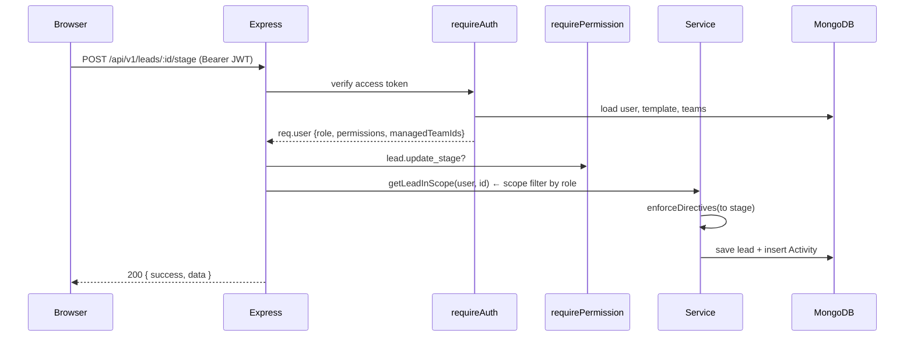
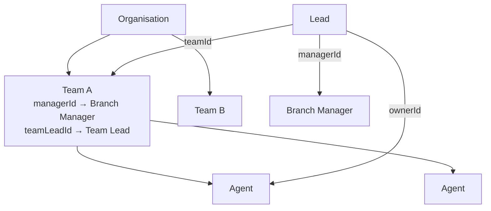
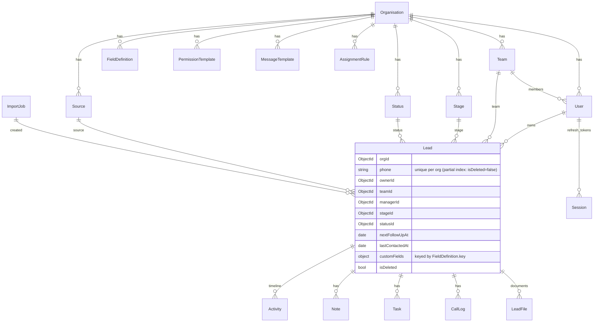
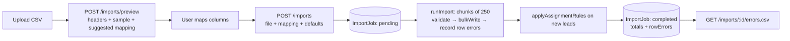

# Architecture

Lead CRM is a two-repo system: a React single-page app (`lead-crm-frontend`) talking to a stateless Node/Express API (`lead-crm-backend`) backed by MongoDB, with lead documents stored in S3.

## System context

```mermaid
flowchart LR
  subgraph Users
    A[Admin] ; BM[Branch Manager] ; TL[Team Lead] ; AG[Calling Agent]
  end
  subgraph AWS
    AMP[Amplify Hosting<br/>React SPA] -->|HTTPS JSON /api/v1| AR[App Runner<br/>Node API container]
    AR --> ATLAS[(MongoDB Atlas)]
    AR -. presigned PUT/GET .-> S3[(S3 bucket<br/>lead documents & import CSVs)]
    AMP -. direct upload via presigned URL .-> S3
  end
  Users --> AMP
  AG -. wa.me / mailto: / tel: deep links .-> EXT[WhatsApp · Mail client · Dialer]
```

* The browser never talks to MongoDB. All data access goes through the API, which enforces authentication, permissions and data-visibility scope on every request.
* File binaries bypass the API: the API only issues a short-lived presigned URL and stores metadata (`LeadFile`). In development `STORAGE_DRIVER=local` makes the API itself accept the `PUT`.
* Communication is deep-link based (no provider keys). `modules/leads` → `communicate` renders a template, returns the link and logs the touch. Swapping in a real WhatsApp/SMS provider is a matter of adding an adapter behind that endpoint.

## Backend layers

```mermaid
flowchart TB
  R[Routes<br/>modules/*/routes.ts] --> V[validate() zod schemas]
  V --> A[requireAuth → requirePermission]
  A --> S[Services<br/>scope · permission · assignment · storage · template · activity]
  S --> M[Mongoose models<br/>models/*]
  M --> DB[(MongoDB)]
  S --> ST[Storage driver<br/>S3 or local]
```

| Layer | Folder | Responsibility |
|---|---|---|
| Config | `src/config` | zod-validated env, pino logger, Mongo connection |
| Common | `src/common` | errors, response helpers, pagination, dates (org timezone), permission catalogue, generic `crudRouter` |
| Middleware | `src/middleware` | `requireAuth` (JWT → `req.user` with resolved permissions), `requirePermission`, `validate`, error handler |
| Services | `src/services` | cross-module logic: data scope filters, permission resolution, assignment engine, storage adapter, template rendering, activity log |
| Modules | `src/modules/*` | one folder per bounded context: auth, users (users/teams/permissions/organisation), config (pipeline/fields/templates/rules/views), leads (+ notes/tasks/calls), files, imports, reports, bootstrap |
| Models | `src/models` | Mongoose schemas + indexes. Every collection carries `orgId` |

### Request lifecycle



## Authorisation model

Two independent mechanisms combine on every request:

1. **What you may do — permissions.** `common/permissions.ts` is the catalogue (`lead.assign`, `lead.bulk_delete`, `admin.pipeline`, …). Each non-admin user resolves to a `PermissionTemplate` (their own, else the role's default, else hard-coded defaults). Admins implicitly hold every key.
2. **What you may see — scope.** `services/scope.service.ts` derives a Mongo filter from the role and the org hierarchy:



| Role | Sees |
|---|---|
| admin | every lead in the org (incl. soft-deleted when `includeDeleted=true`) |
| branch_manager | leads whose `teamId` is in the teams they manage, plus their own |
| team_lead | leads in their team, plus their own |
| agent | leads they own |

Leads denormalise `ownerId → teamId → managerId` at assignment time so list queries are single-index lookups; team changes rewrite these fields.

## Data model



Key indexing choices (see `models/Lead.ts`): compound `{orgId, isDeleted, ownerId|teamId|stageId|statusId|sourceId|nextFollowUpAt|lastContactedAt|assignedAt}` cover every list tab; a partial unique index on `{orgId, phone}` enforces deduplication while allowing soft-deleted duplicates.

## Tenancy

Single company today; multi-tenant ready. Every collection is keyed by `orgId`, every query is org-scoped through `req.user.orgId`, and unique indexes are compound with `orgId`. Enabling multiple tenants later means: seed a second `Organisation`, create its admin, and (optionally) resolve `orgId` from a subdomain during login. No schema migration is needed.

## Frontend structure

```
src/
  lib/        api.ts (axios + refresh interceptor), utils.ts
  store/      auth (zustand, persisted), theme, bootstrap (react-query)
  components/ ui/ primitives · layout/AppShell · fields/DynamicField
  pages/      LoginPage · DashboardPage · leads/ · reports/ · admin/
```

* **Bootstrap** (`GET /bootstrap`) loads stages, statuses, sources, field definitions, templates, directives, users and teams once after login; all dropdowns read from it. Admin mutations invalidate it.
* **Dynamic fields**: `FieldDefinition` drives the create form (step 2), the lead-detail tabs/sections, list columns and filters via `DynamicInput`/`fieldValue`. Adding a field in Admin needs no frontend change.
* **Admin config pages** share one `ConfigCrudPage` driven by a spec (`configSpecs.tsx`), mirroring the backend `crudRouter`.
* Theme: CSS variables on `:root`/`.dark`, toggled with a class; Tailwind reads the variables.

## Import pipeline



Processing runs in-process on `setImmediate` so it works on a single App Runner instance without a queue. For very large volumes the same `runImport` can be moved to a worker (SQS/Lambda) without changing the API contract — the job document is the shared state.

## Notifications & reminders

```mermaid
flowchart LR
  A[Lead events<br/>assign · note · stage · status] --> N[notify()<br/>dedupeKey]
  S[Scheduler tick<br/>every 60 s] --> N
  S --> T[dispatchDueTopUps]
  T --> N
  N --> DB[(Notification)]
  DB --> B[Bell + panel<br/>polls /unread-count every 30 s]
  DB --> P[Persistent pop-ups<br/>high priority]
```

Follow-ups due/overdue, task and note reminders and top-up reminders are generated by an in-process scheduler; every generated row carries a `dedupeKey` (unique partial index), so multiple API instances cannot create duplicates. Notifications stay until completed/dismissed; snoozed rows are woken by the scheduler. Reassigning a lead re-targets its pending reminders and the top-up reminder to the new owner.

## Document / training visibility

`services/access.service.ts` implements one audience model (`all | roles | teamIds | userIds`) for folders, documents and training. When both roles and teams are selected a user must match **both** (e.g. Personal-Loan agents only). Non-admins never receive a file URL: the client requests a 5-minute token bound to `{user, document}` and the API streams the bytes inline with `Content-Disposition: inline`; the download endpoint requires `files.download`.

## Login / logout sessions

Every successful sign-in creates one `Session` row (`loginAt`, `lastSeenAt`, team/role snapshot, refresh-token hash). `requireAuth` bumps `lastSeenAt` at most once a minute per session; logout, "sign out everywhere", password change and deactivation set `endedAt`/`endReason` with the real end time. The scheduler sweeps sessions whose refresh token expired or that were idle past `SESSION_INACTIVITY_MINUTES` and closes them as `expired` at their **last observed activity** — a browser that was simply closed never gets a fabricated logout time. Reports → Login & Logout reads these rows (team-scoped) and computes online status, live duration, average first-login time and average session length in the organisation timezone.

## Admin-configurable UI

`src/common/uiconfig.ts` is the catalogue of lead-page tabs, dashboard widgets and quick actions. Admin edits are validated by zod, normalised against the catalogue (unknown keys dropped, new keys appended, order renumbered) and stored on `Organisation.settings`; `/bootstrap` always returns the normalised result so the SPA never needs defaults of its own. Permissions still gate every widget/action at render time and every API call behind it.

## Security notes

* 2FA: email OTP (6 digits, 5-minute TTL, 5 attempts, hashed with a server pepper, resend cool-down), enabled per user by admins.
* Access tokens carry the session id; `requireAuth` checks the session row so logout/password change invalidates access tokens immediately (one indexed lookup).
* Account lockout after 5 failed logins; `passwordHash` is `select: false` and stripped from every serialiser.
* `sanitizeInput` strips `$`-prefixed keys from bodies/queries; zod validates every route; optional `X-Client-Key` shared header blocks casual third-party clients.
* Sensitive profile fields (bank account, PAN) are AES-256-GCM encrypted; Meta access tokens likewise.
* Append-only `AuditLog` for administrative changes (before/after, user, IP).

* Passwords: bcrypt (cost 10). Access JWT 15 min; refresh JWT 7 days, stored hashed with rotation and server-side revocation (`Session`). Password change revokes all sessions.
* Helmet, CORS allow-list, rate limiting (global + stricter on login), 2 MB JSON limit, request IDs in logs, secrets redacted.
* Every route is authenticated except `/health`, `/auth/login|refresh|logout` and the local-storage upload endpoint (which requires a signed token in the query string).
* Soft delete for leads; immutable `Activity` audit trail; "erase history" hides rather than deletes (admins can still audit).
